# Домашнее задание к занятию «Запуск приложений в K8S» - Лукинов Андрей

<b>Задание 1. Создать Deployment и обеспечить доступ к репликам приложения из другого Pod</b>

1. Создать Deployment приложения, состоящего из двух контейнеров — nginx и multitool. Решить возникшую ошибку.

    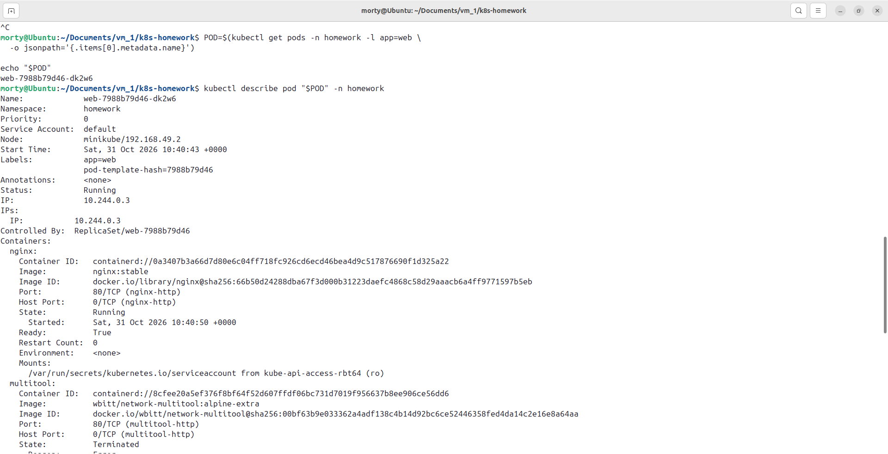

    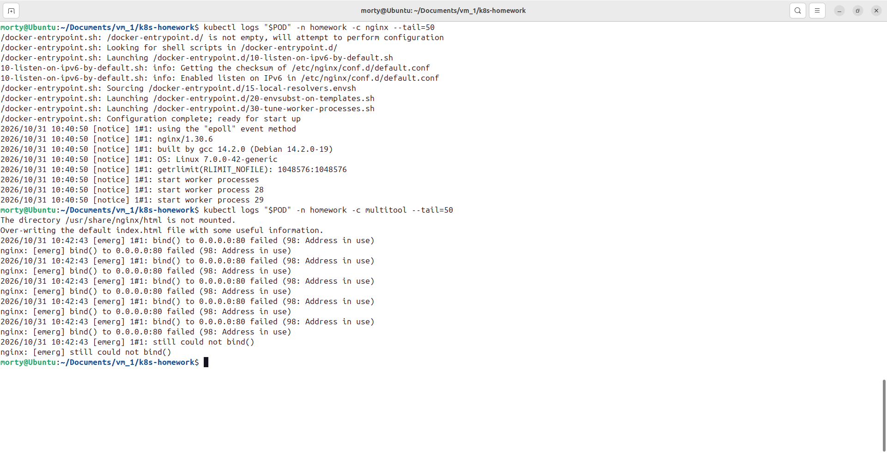

2. После запуска увеличить количество реплик работающего приложения до 2.
3. Продемонстрировать количество подов до и после масштабирования.

    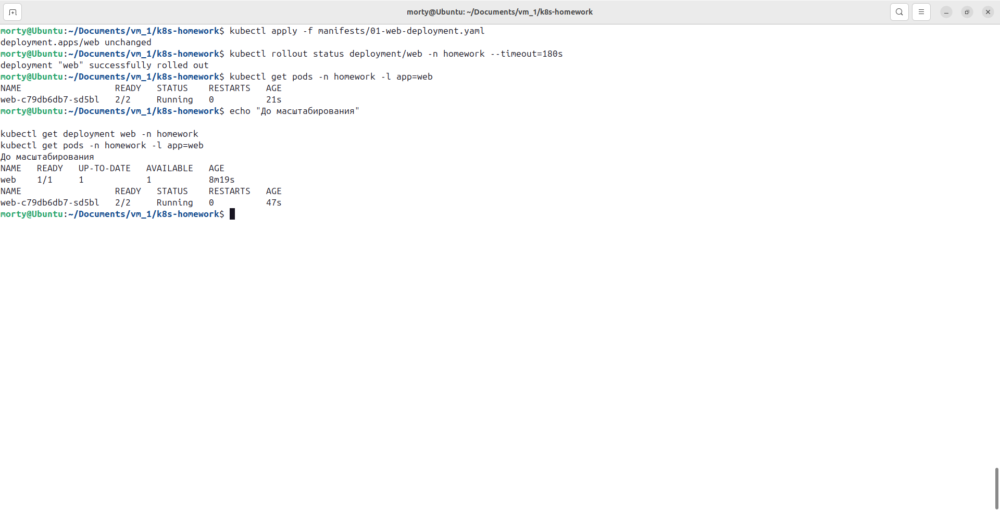

    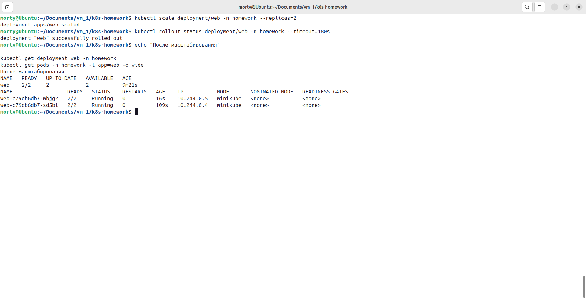

4. Создать Service, который обеспечит доступ до реплик приложений из п.1.

    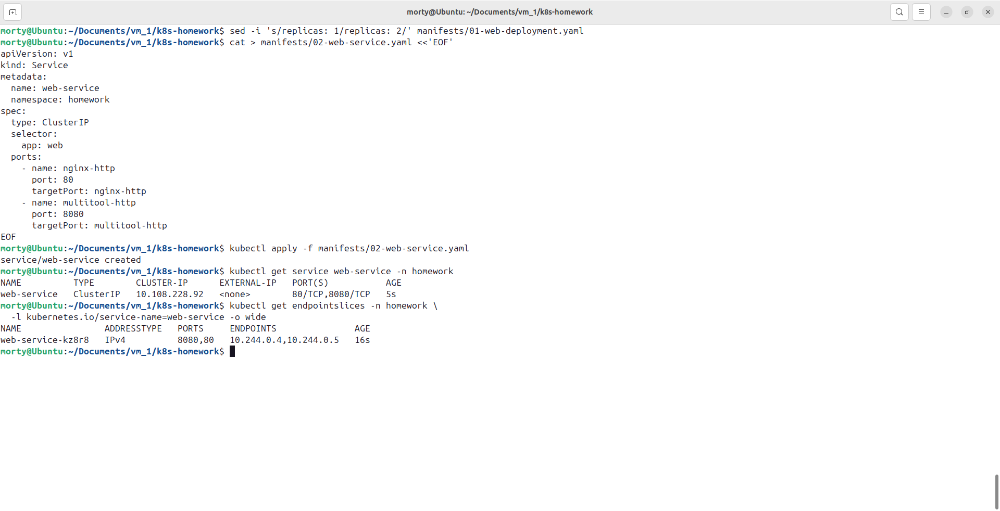

5. Создать отдельный Pod с приложением multitool и убедиться с помощью `curl`, что из пода есть доступ до приложений из п.1.

    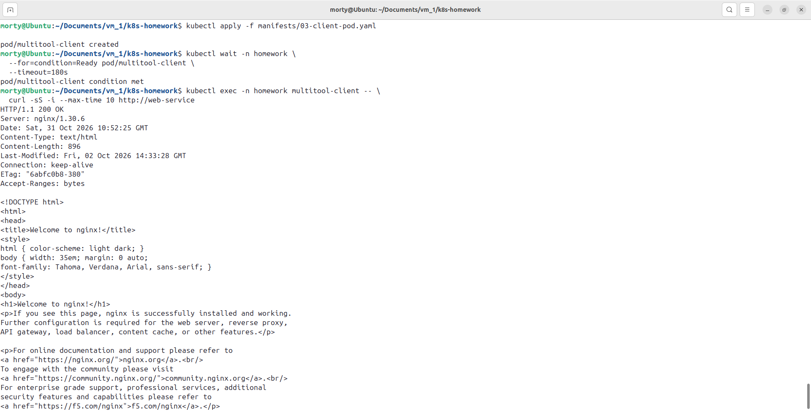

    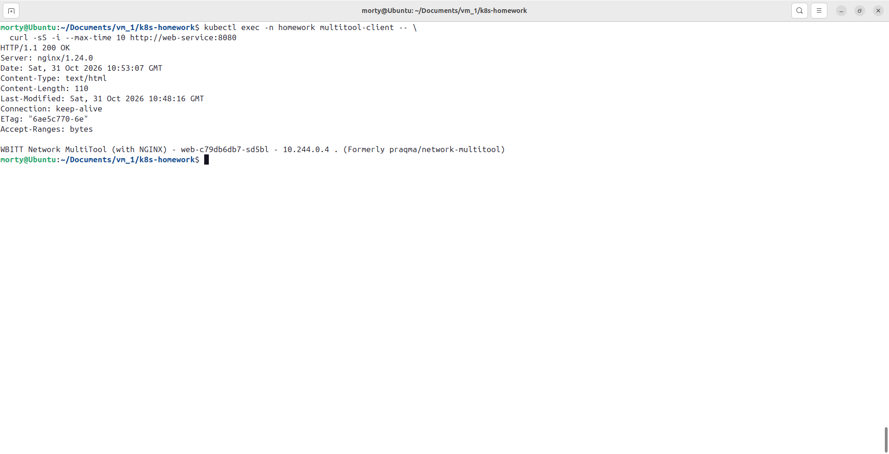

    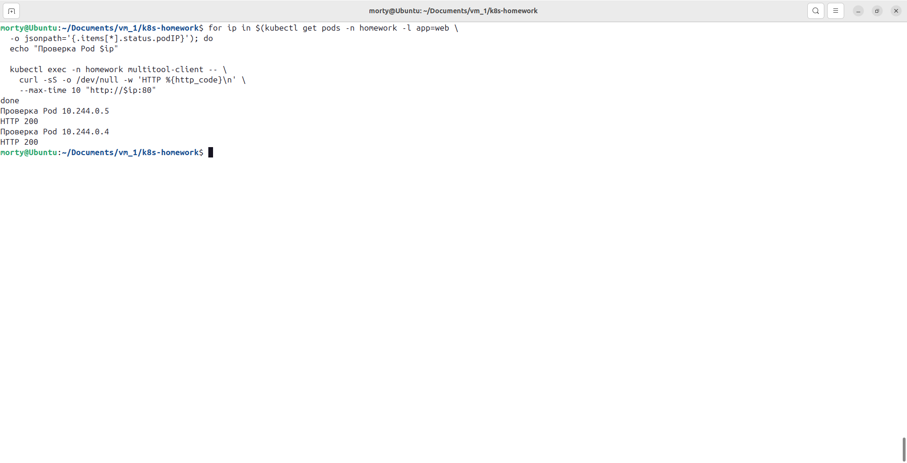

[Ссылка на файлы](./files/task-1/)

---

<b>Создан Deployment web, первоначально с одной репликой и двумя контейнерами: nginx и multitool. При запуске обнаружен конфликт порта 80, поскольку multitool также запускает веб-сервер nginx. Конфликт устранён настройкой переменных HTTP_PORT=8080 и HTTPS_PORT=8443 у контейнера multitool.

После исправления оба контейнера перешли в состояние Ready. Количество реплик Deployment увеличено с одной до двух. Создан Service web-service, предоставляющий доступ к nginx на порту 80 и multitool на порту 8080.

Из отдельного Pod multitool-client выполнены запросы curl через Service. Получены ответы HTTP 200. Дополнительно проверена доступность каждой реплики по IP Pod.</b>

---

<b>Задание 2. Создать Deployment и обеспечить старт основного контейнера при выполнении условий</b>

1. Создать Deployment приложения nginx и обеспечить старт контейнера только после того, как будет запущен сервис этого приложения.

    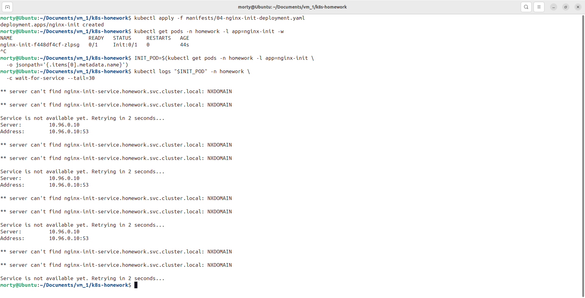

2. Убедиться, что nginx не стартует. В качестве Init-контейнера взять busybox.

    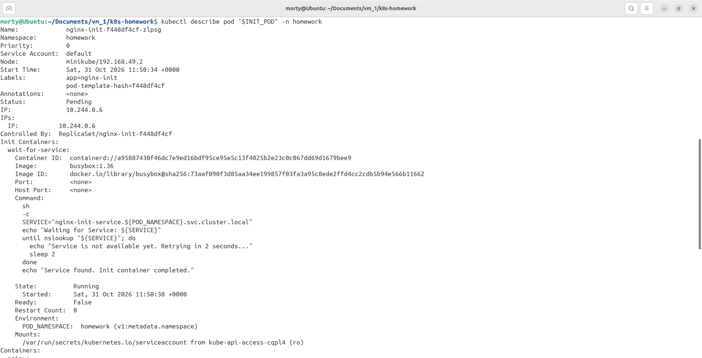

    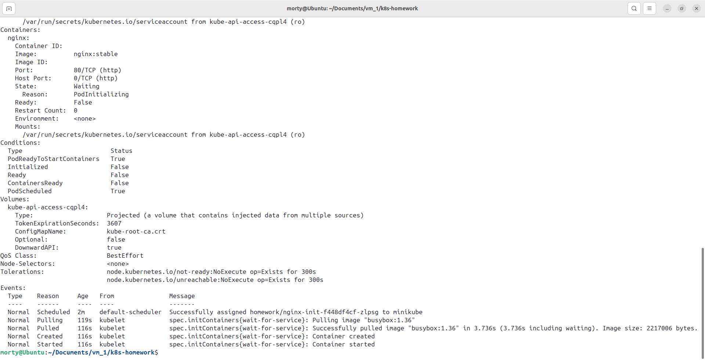

3. Создать и запустить Service. Убедиться, что Init запустился.

    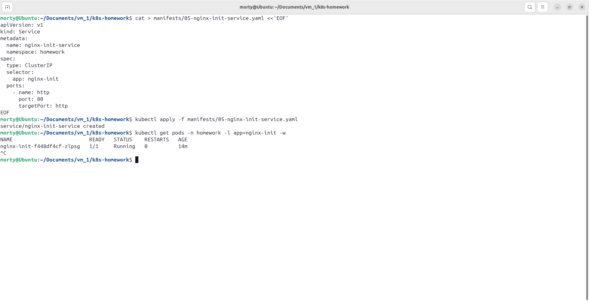

    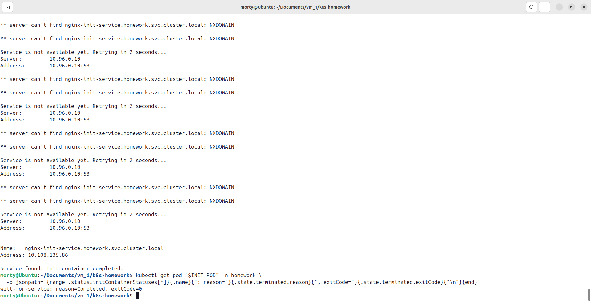

4. Продемонстрировать состояние пода до и после запуска сервиса.

    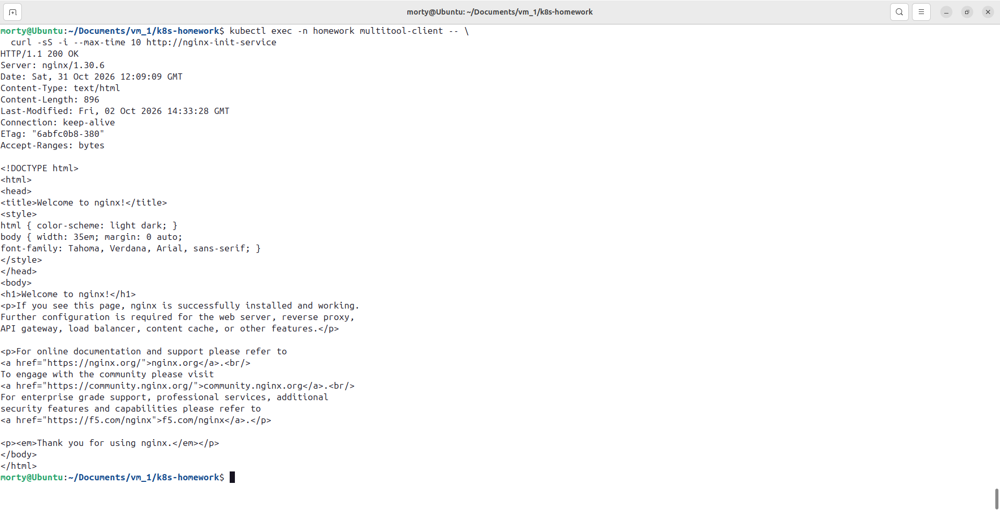

    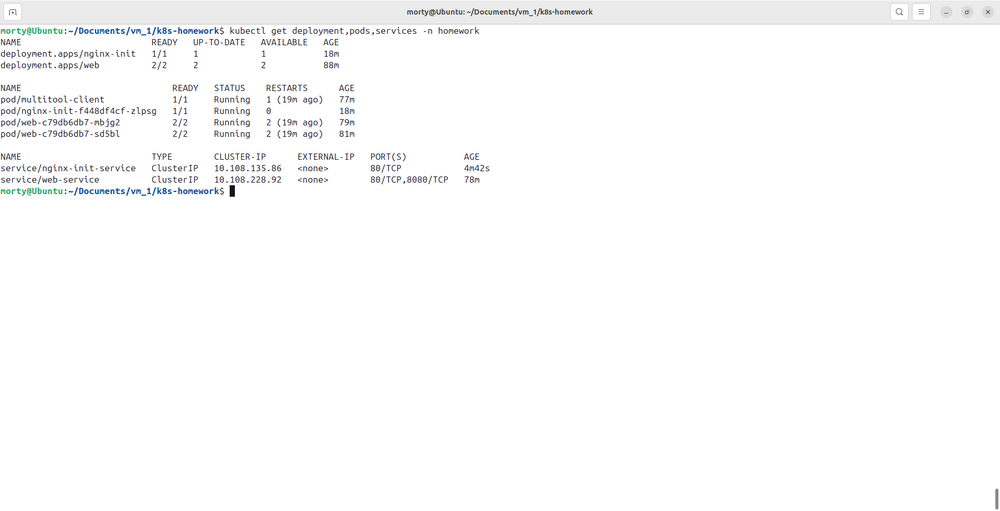

[Ссылка на файлы](./files/task-2/)

---

<b>Создан Deployment nginx-init с основным контейнером nginx и Init-контейнером wait-for-service на базе BusyBox.

Init-контейнер циклически проверяет разрешение DNS-имени nginx-init-service.homework.svc.cluster.local. До создания Service Pod находится в состоянии Init:0/1, основной контейнер nginx — в состоянии ожидания PodInitializing.

После создания Service nginx-init-service DNS-проверка завершилась успешно. Init-контейнер завершился с причиной Completed и кодом 0. После этого nginx запустился, Pod перешёл в состояние 1/1 Running. Доступ к nginx проверен запросом curl из Pod multitool-client, получен ответ HTTP 200.</b>

