# Домашнее задание к занятию «Сетевое взаимодействие в Kubernetes» - Лукинов Андрей

<details>
<summary><b>Задание 1: Настройка Service (ClusterIP и NodePort)</b></summary>

**Задача:**

Развернуть приложение из двух контейнеров (`nginx` и `multitool`) и обеспечить доступ к ним:
- Внутри кластера через **ClusterIP**.
- Снаружи через **NodePort**.

**Шаги выполнения:**

1. **Создать Deployment** с двумя контейнерами:
   - `nginx` (порт `80`).
   - `multitool` (порт `8080`).
   - Количество реплик: `3`.

    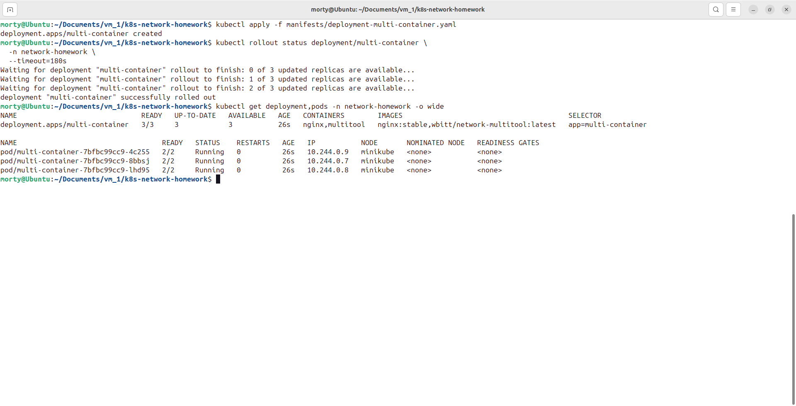

2. **Создать Service типа ClusterIP**, который:
   - Открывает `nginx` на порту `9001`.
   - Открывает `multitool` на порту `9002`.

    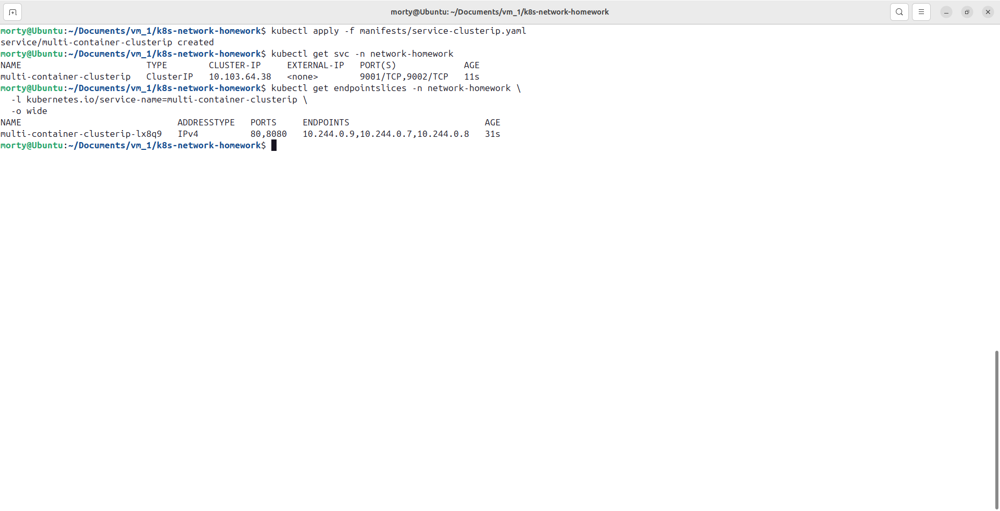

3. **Проверить доступность** изнутри кластера:

    ```bash
    kubectl run test-pod --image=wbitt/network-multitool --rm -it -- sh
    curl <service-name>:9001 # Проверить nginx
    curl <service-name>:9002 # Проверить multitool
    ```

    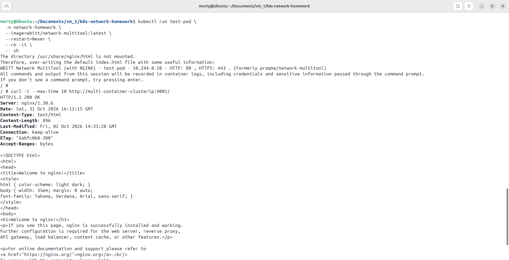

    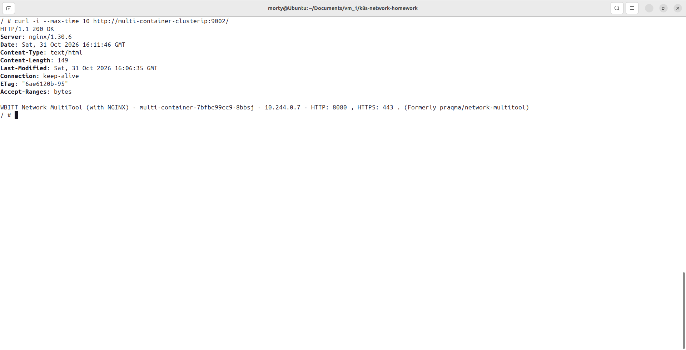

4. **Создать Service типа NodePort** для доступа к `nginx` снаружи.

    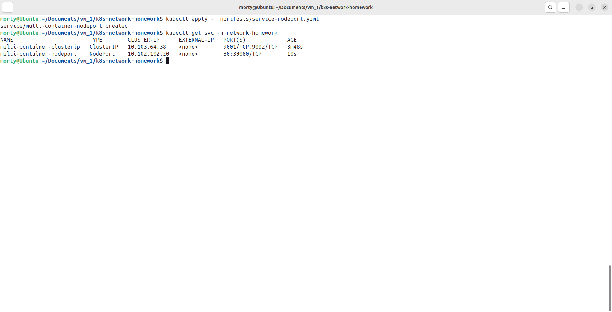

5. **Проверить доступ** с локального компьютера:
    
    ```bash
    curl <node-ip>:<node-port>
    ```
    или через браузер.

    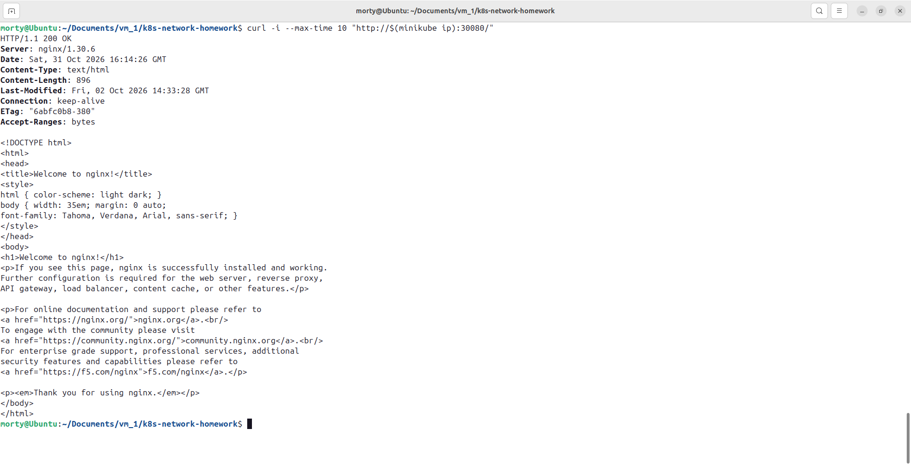

    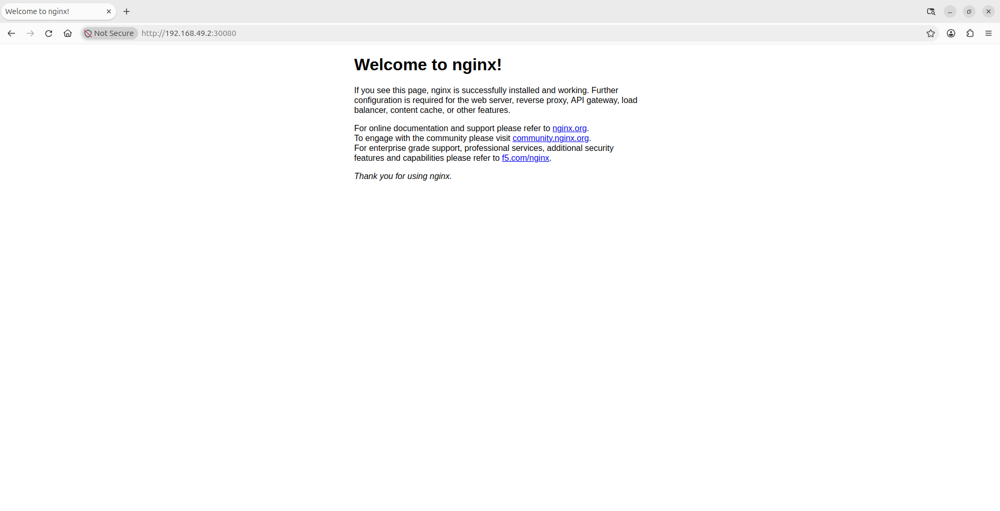

    [Манифесты](./files/task-1/)

</details>

---

<details>
<summary><b>Задание 2: Настройка Ingress</b></summary>

**Задача:**

Развернуть два приложения (`frontend` и `backend`) и обеспечить доступ к ним через **Ingress** по разным путям.

**Шаги выполнения:**

1. **Развернуть два Deployment**:
   - `frontend` (образ `nginx`).
   - `backend` (образ `wbitt/network-multitool`).
  
    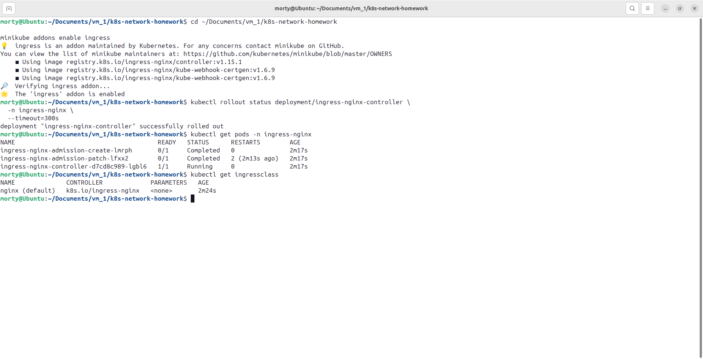

2. **Создать Service** для каждого приложения.

    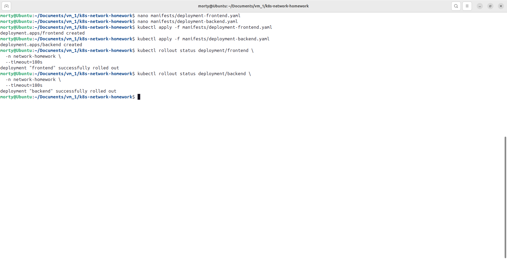
    
    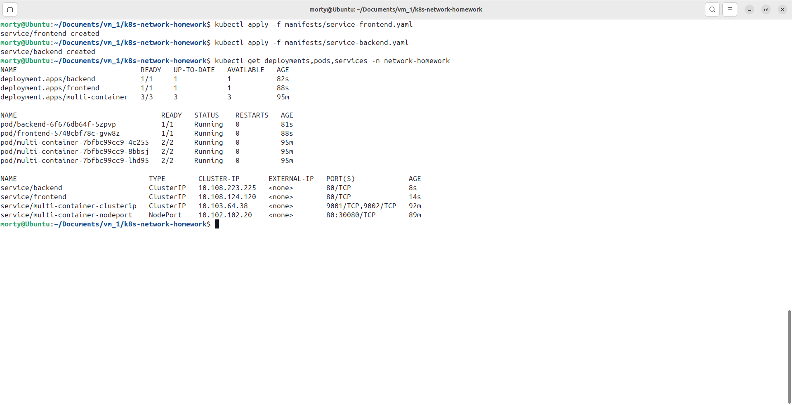

3. **Включить Ingress-контроллер**:
   
    ```bash
    microk8s enable ingress
    ```

    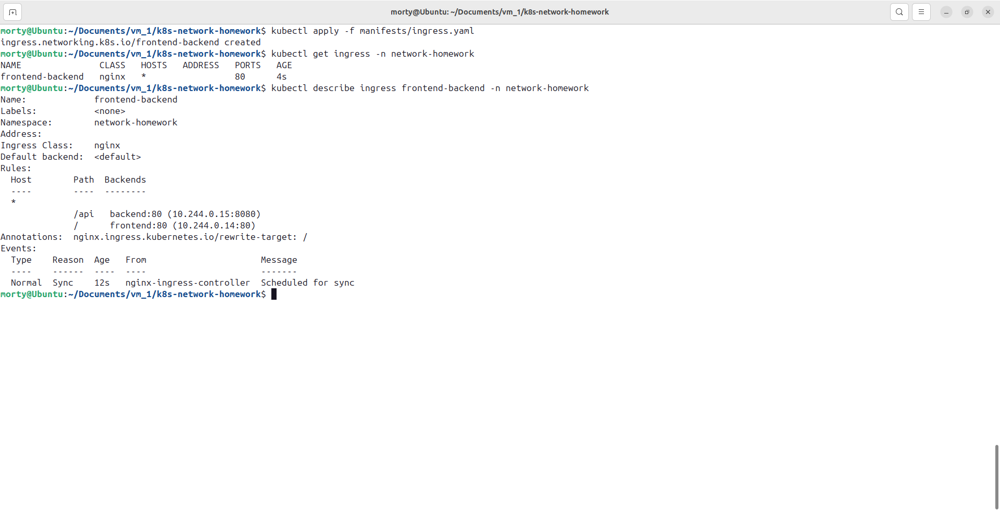

4. **Создать Ingress**, который:
   - Открывает `frontend` по пути `/`.
   - Открывает `backend` по пути `/api`.
5. **Проверить доступность**:

    ```bash
    curl <host>/
    curl <host>/api
    ```
    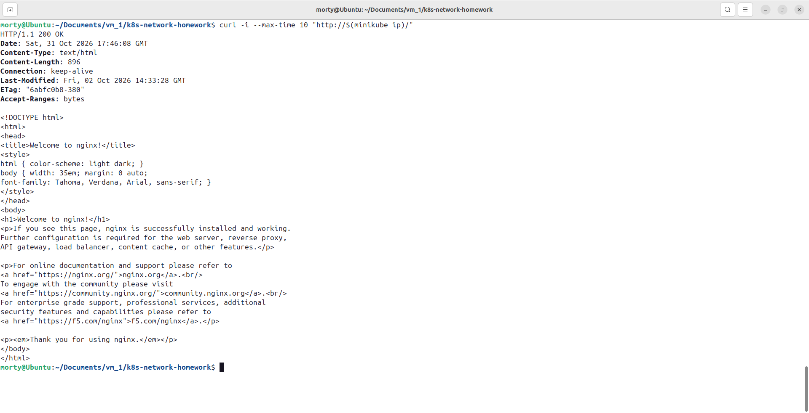

    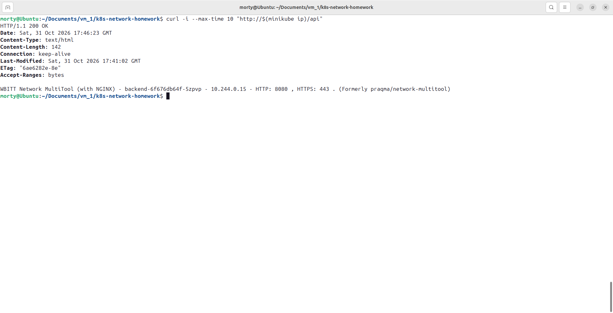

    [Манифесты](./files/task-2/)

</details>