# Домашнее задание к занятию «Хранение в K8s» - Лукинов Андрей

<b>Задание 1. Volume: обмен данными между контейнерами в поде</b>

### Задача

Создать Deployment приложения, состоящего из двух контейнеров, обменивающихся данными.

### Шаги выполнения

1. Создать Deployment приложения, состоящего из контейнеров busybox и multitool.

    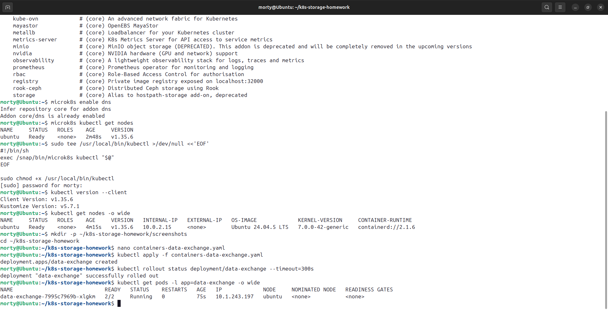

2. Настроить busybox на запись данных каждые 5 секунд в некий файл в общей директории.

    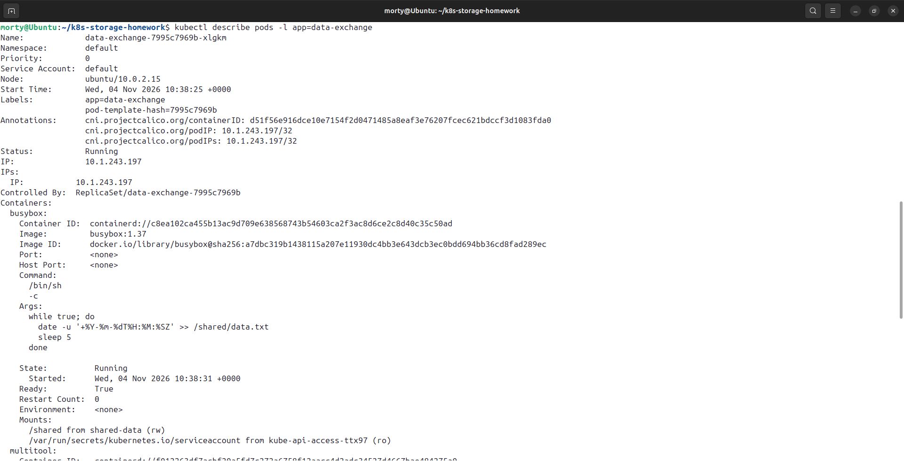

3. Обеспечить возможность чтения файла контейнером multitool.

    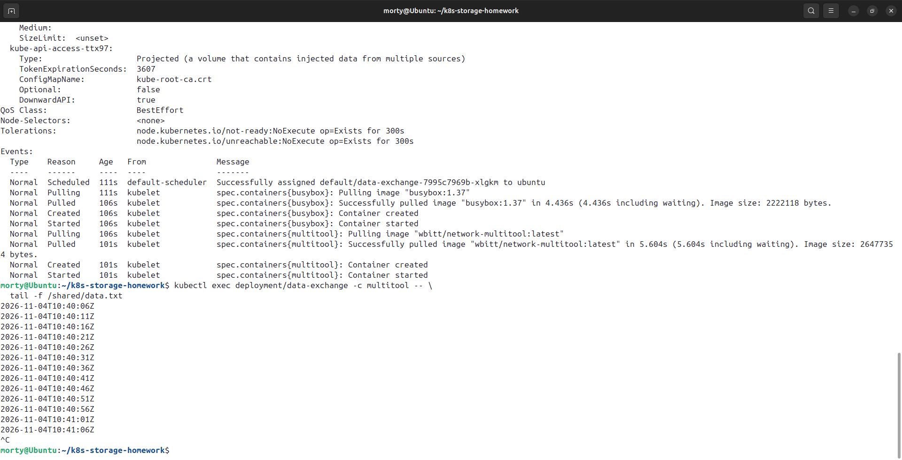

    [containers-data-exchange.yaml](./files/containers-data-exchange.yaml)

---

<b>Задание 2. PV, PVC</b>

### Задача

Создать Deployment приложения, использующего локальный PV, созданный вручную.

### Шаги выполнения

1. Создать Deployment приложения, состоящего из контейнеров busybox и multitool, использующего созданный ранее PVC

    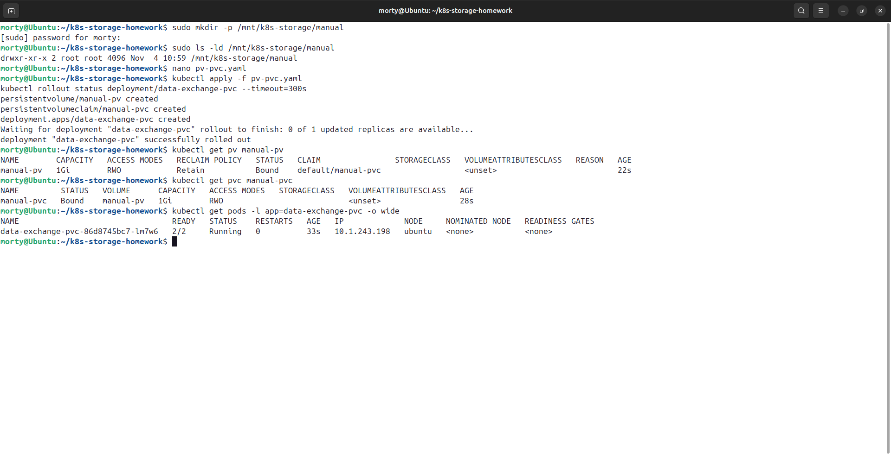

2. Создать PV и PVC для подключения папки на локальной ноде, которая будет использована в поде.

    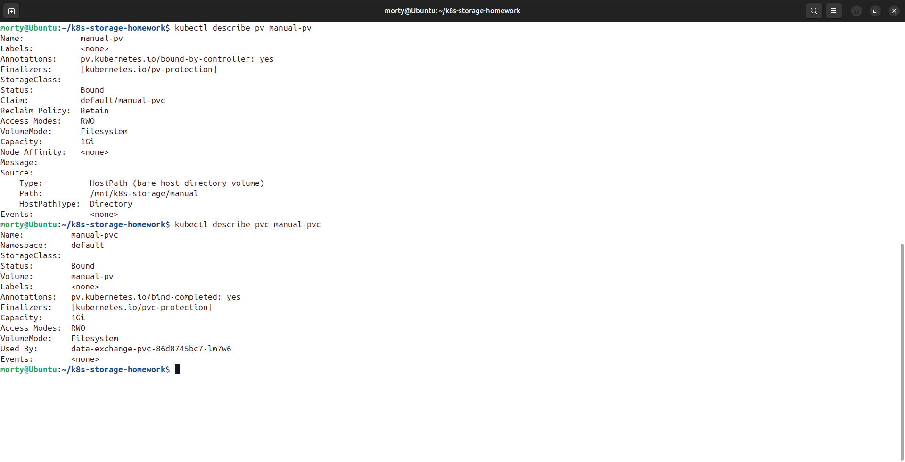

3. Продемонстрировать, что контейнер multitool может читать данные из файла в смонтированной директории, в который busybox записывает данные каждые 5 секунд.

    

    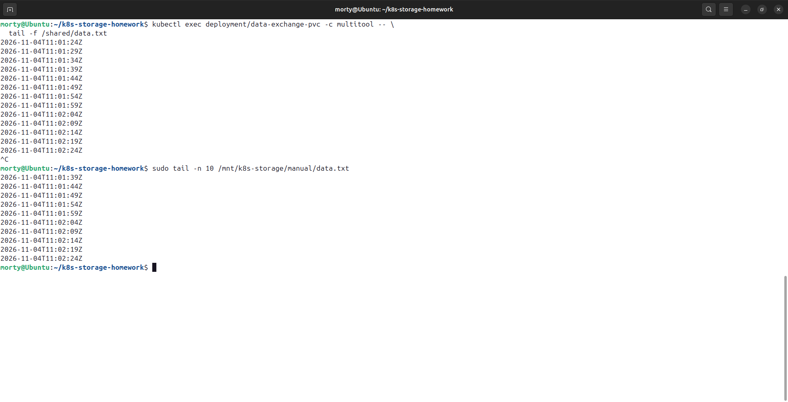

4. Удалить Deployment и PVC. Продемонстрировать, что после этого произошло с PV. Пояснить, почему. (Используйте команду `kubectl describe pv`).

    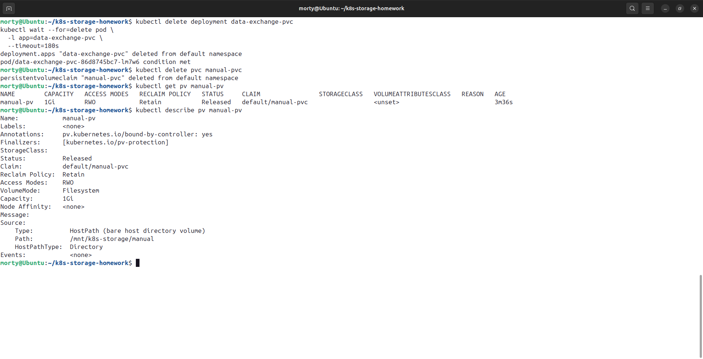

5. Продемонстрировать, что файл сохранился на локальном диске ноды. Удалить PV.  Продемонстрировать, что произошло с файлом после удаления PV. Пояснить, почему.

    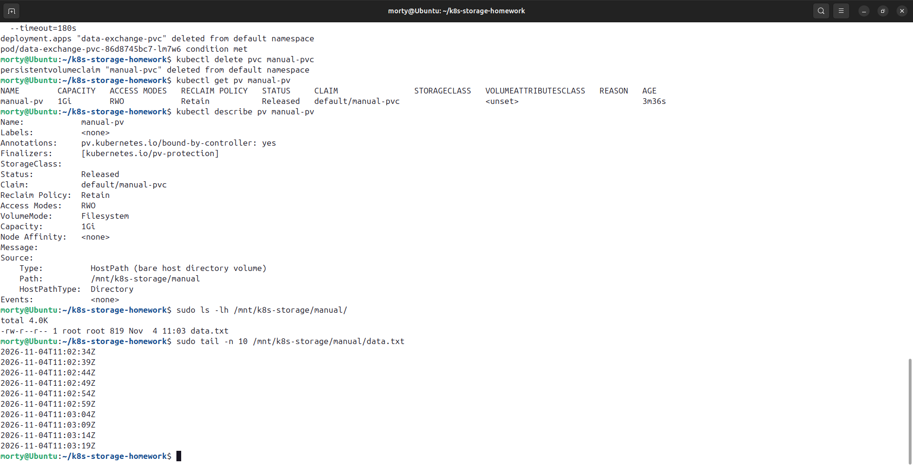

    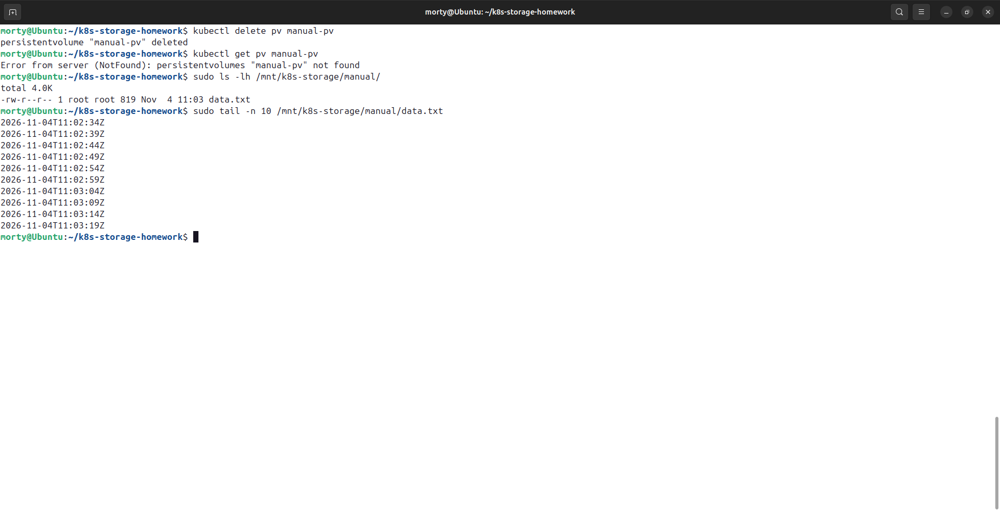

    [pv-pvc.yaml](./files/pv-pvc.yaml)

Для PV manual-pv была установлена политика освобождения Retain. После удаления Deployment и PVC том перешёл из состояния Bound в Released. PV не был автоматически удалён и не стал доступным для новой привязки без действий администратора.

Файл сохранился в каталоге /mnt/k8s-storage/manual на ноде. После удаления самого объекта PV каталог и файл также остались: в данном стенде PV описывал существующий каталог hostPath, а удаление объекта Kubernetes не выполняло очистку этого каталога. Для удаления оставшихся данных потребовалось бы отдельное действие администратора.

---

<b>Задание 3. StorageClass</b>

### Задача

Создать Deployment приложения, использующего PVC, созданный на основе StorageClass.

### Шаги выполнения

1. Создать Deployment приложения, состоящего из контейнеров busybox и multitool, использующего созданный ранее PVC.

    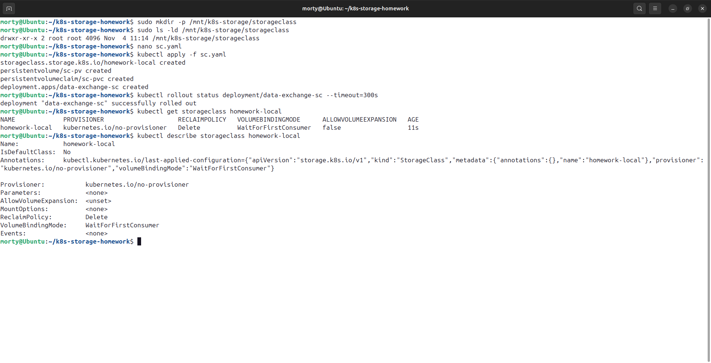

2. Создать SC и PVC для подключения папки на локальной ноде, которая будет использована в поде.

    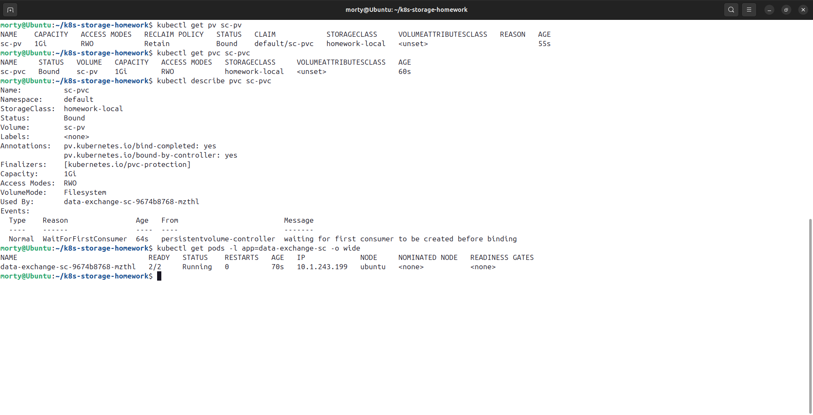

3. Продемонстрировать, что контейнер multitool может читать данные из файла в смонтированной директории, в который busybox записывает данные каждые 5 секунд.

    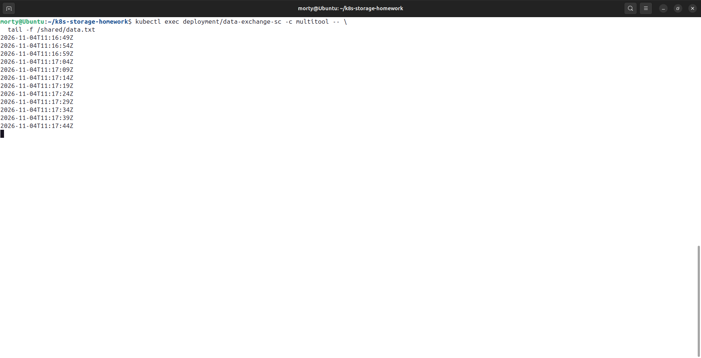

    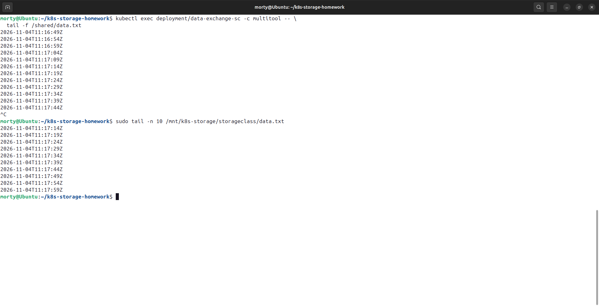

    [sc.yaml](./files/sc.yaml)

Создан StorageClass homework-local с provisioner kubernetes.io/no-provisioner и режимом WaitForFirstConsumer. Этот класс не создаёт PV автоматически, поэтому PV sc-pv был создан вручную.

В PV и PVC указан одинаковый storageClassName: homework-local. После создания Pod, использующего PVC, произошла привязка к подходящему PV. Контейнер busybox записывает время в общий файл каждые 5 секунд, а контейнер multitool читает этот файл.

---