# Домашнее задание к занятию «Настройка приложений и управление доступом в Kubernetes» - Лукинов Андрей

<details>
<summary><b>Задание 1: Работа с ConfigMaps</b></summary>

### Задача

Развернуть приложение (nginx + multitool), решить проблему конфигурации через ConfigMap и подключить веб-страницу.

### Шаги выполнения

1. **Создать Deployment** с двумя контейнерами
   - `nginx`
   - `multitool`

2. **Подключить веб-страницу** через ConfigMap
3. **Проверить доступность**

    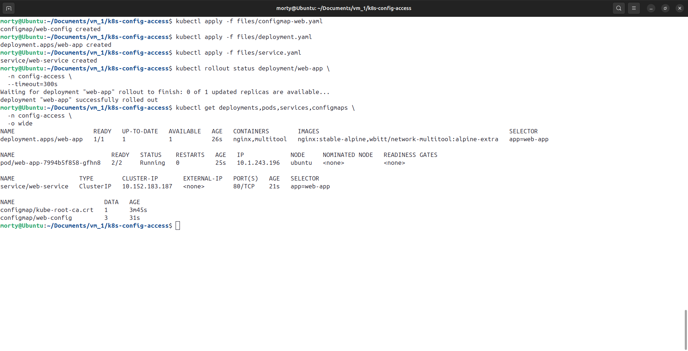

    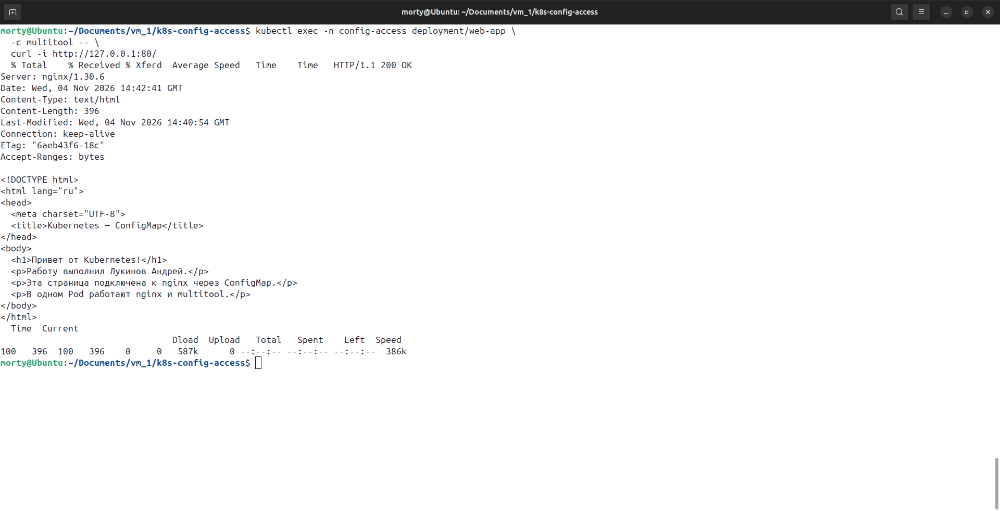

    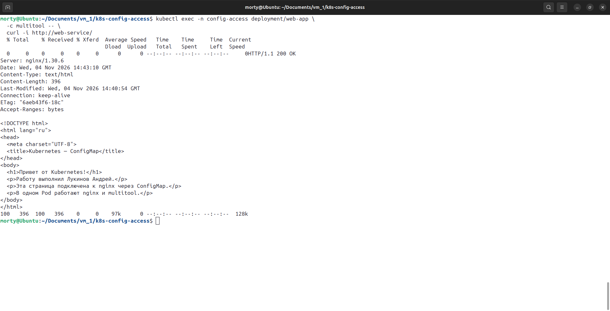

    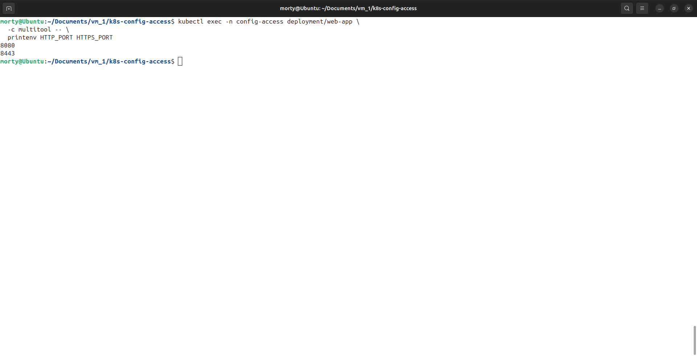

    [deployment.yaml](./files/deployment.yaml)

    [configmap-web.yaml](./files/configmap-web.yaml)

    [namespace.yaml](./files/namespace.yaml)

    [service.yaml](./files/service.yaml)

</details>

---

<details>
<summary><b>Задание 2: Настройка HTTPS с Secrets</b></summary>

### Задача

Развернуть приложение с доступом по HTTPS, используя самоподписанный сертификат.

### Шаги выполнения

1. **Сгенерировать SSL-сертификат**
```bash
openssl req -x509 -nodes -days 365 -newkey rsa:2048 \
  -keyout tls.key -out tls.crt -subj "/CN=myapp.example.com"
```
2. **Создать Secret**
3. **Настроить Ingress**
4. **Проверить HTTPS-доступ**

    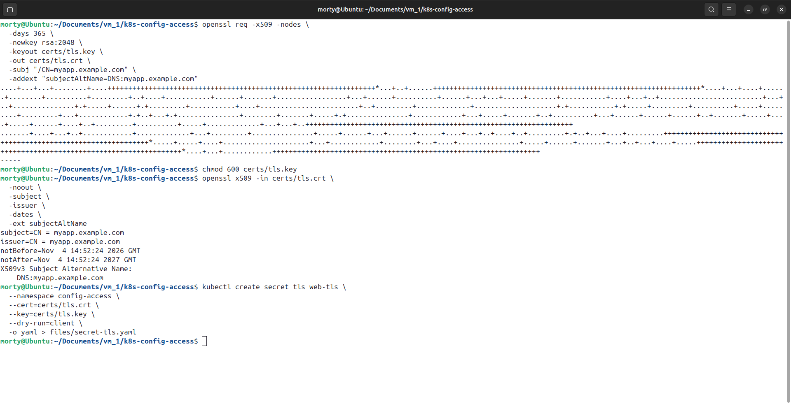

    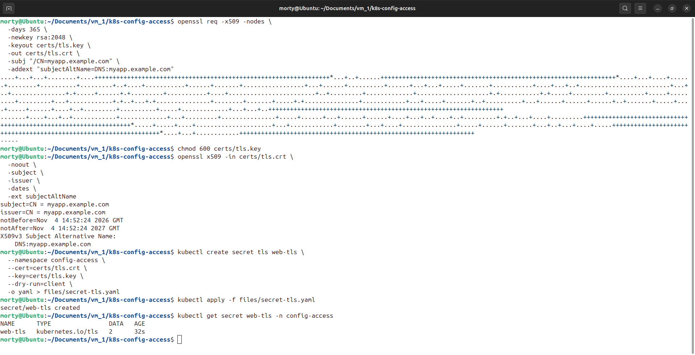

    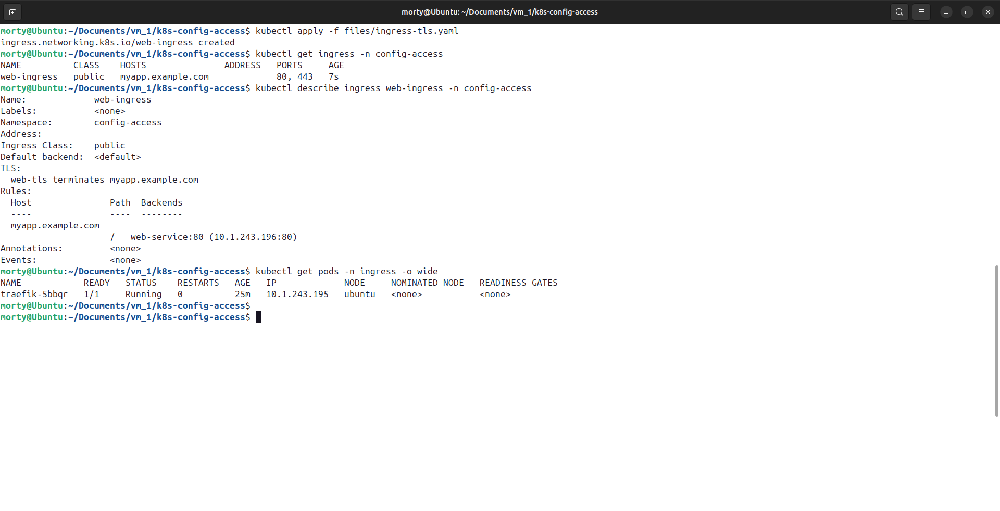

    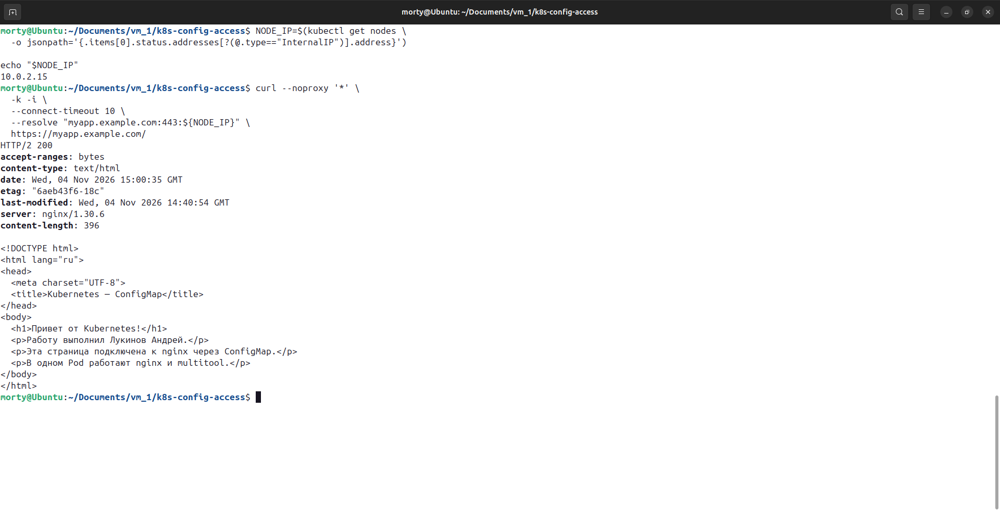

    [secret-tls.yaml](./files/secret-tls.yaml)

    [ingress-tls.yaml](./files/ingress-tls.yaml)

</details>

---

<details>
<summary><b>Задание 3: Настройка RBAC</b></summary>

### Задача

Создать пользователя с ограниченными правами (только просмотр логов и описания подов).

### Шаги выполнения

1. **Включите RBAC в microk8s**
```bash
microk8s enable rbac
```
2. **Создать SSL-сертификат для пользователя**
```bash
openssl genrsa -out developer.key 2048
openssl req -new -key developer.key -out developer.csr -subj "/CN={ИМЯ ПОЛЬЗОВАТЕЛЯ}"
openssl x509 -req -in developer.csr -CA {CA серт вашего кластера} -CAkey {CA ключ вашего кластера} -CAcreateserial -out developer.crt -days 365
```
3. **Создать Role (только просмотр логов и описания подов) и RoleBinding**
4. **Проверить доступ**

    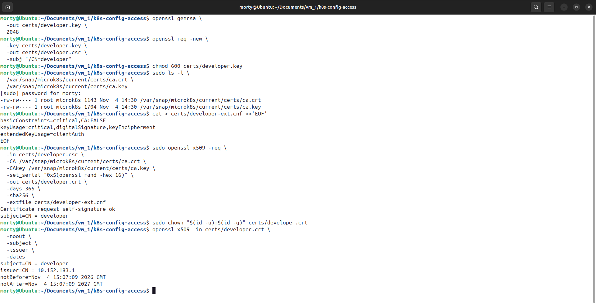

    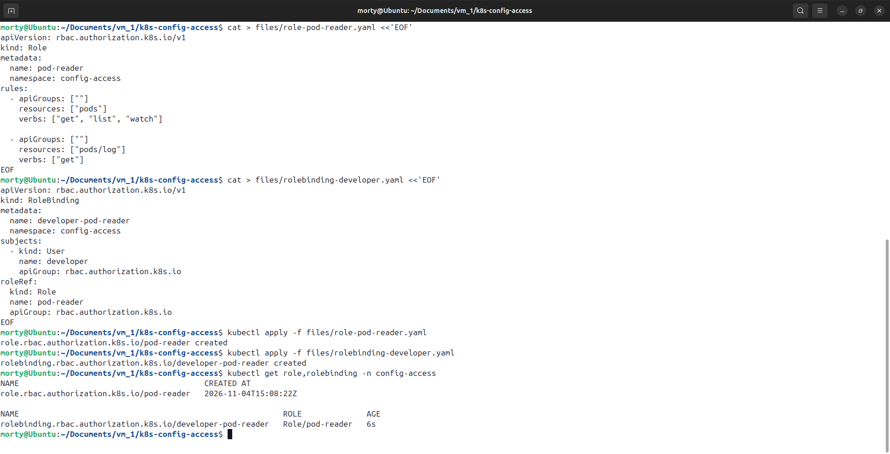

    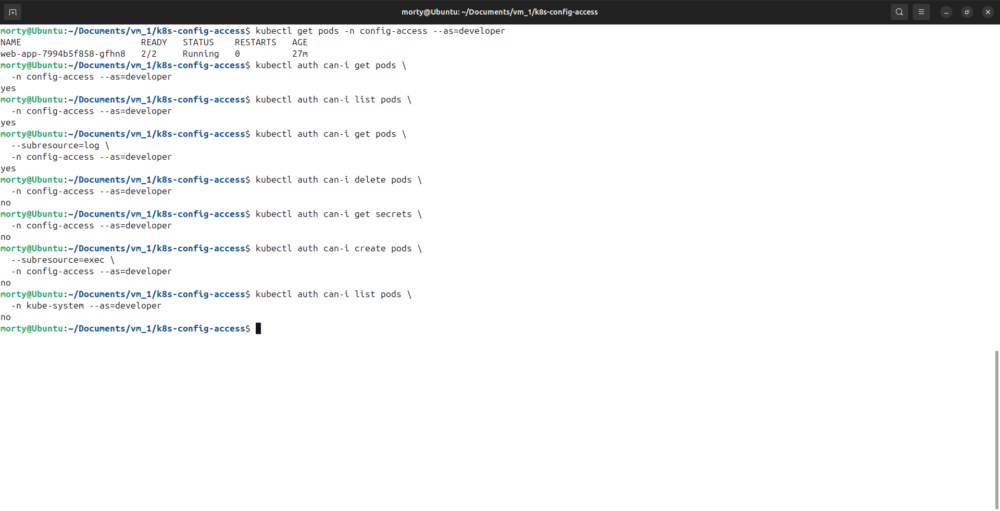

    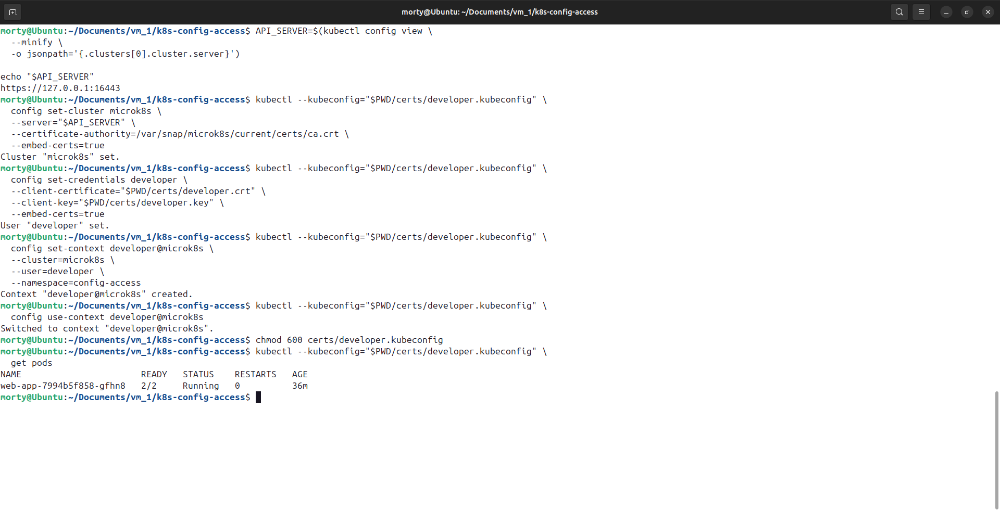

    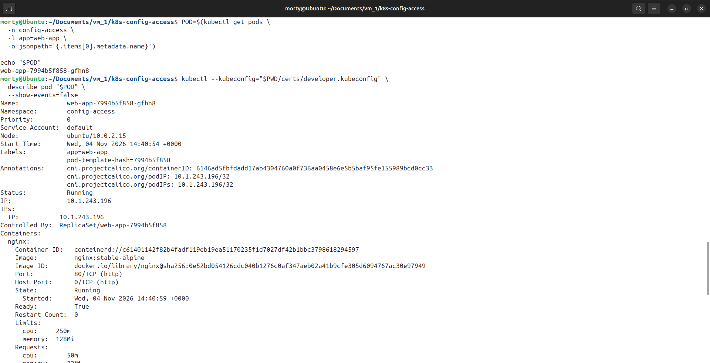

    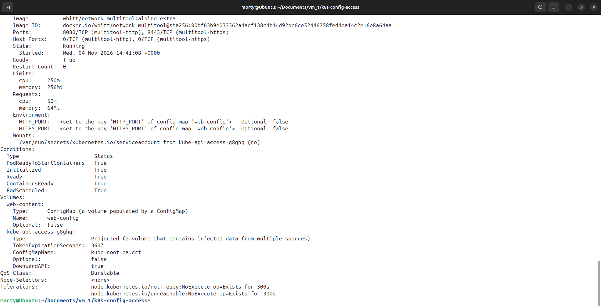

    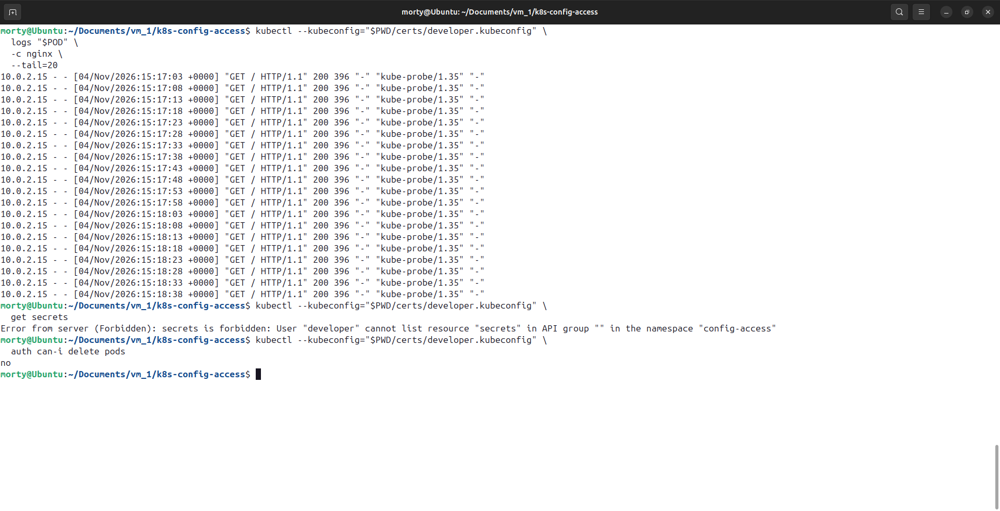

    [role-pod-reader.yaml](./files/role-pod-reader.yaml)

    [rolebinding-developer.yaml](./files/rolebinding-developer.yaml)

</details>