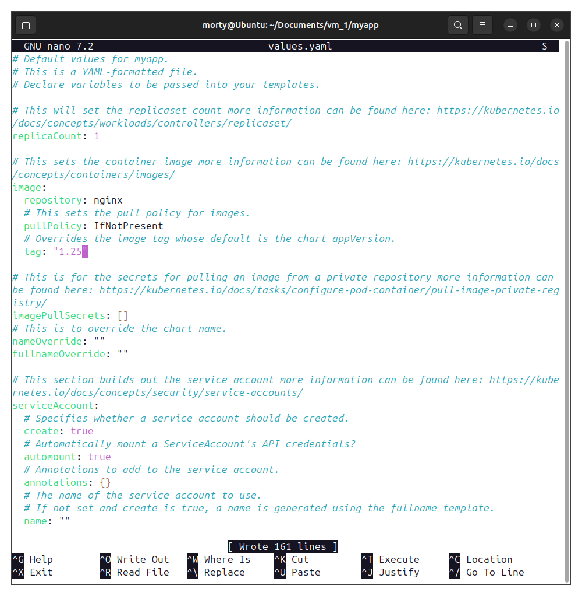
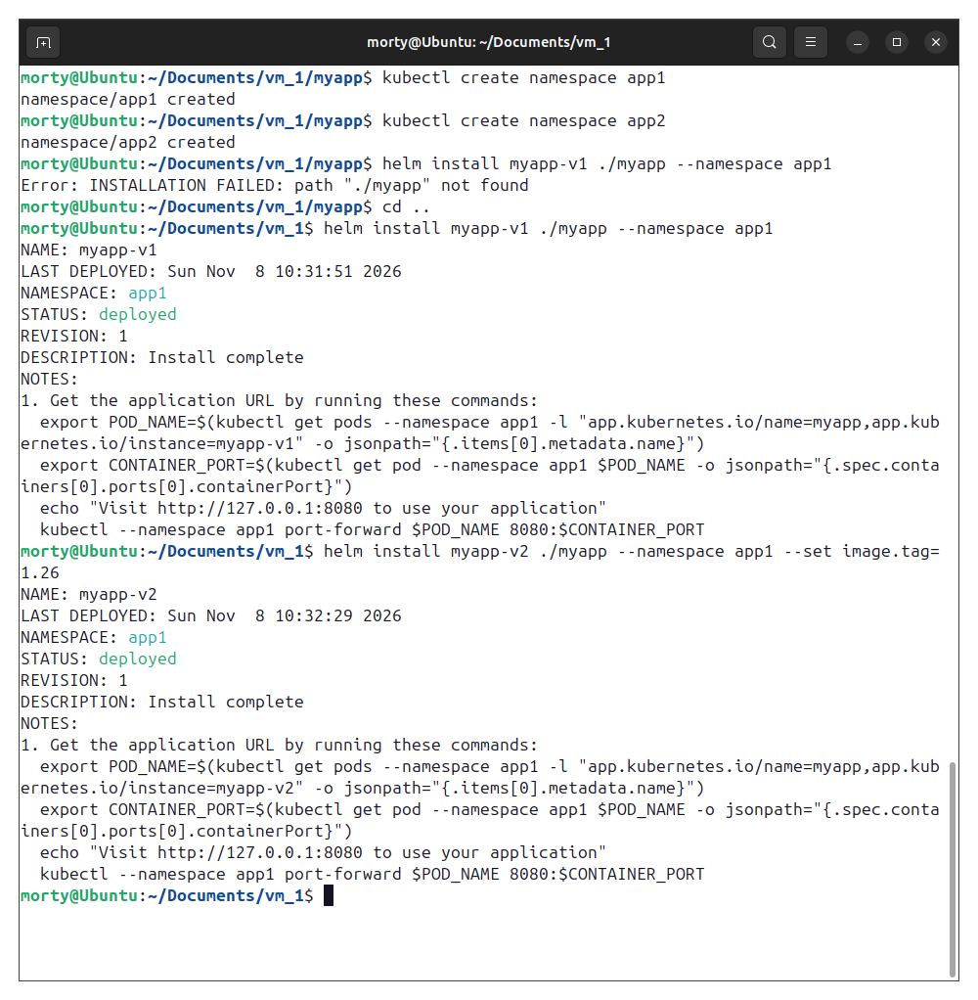
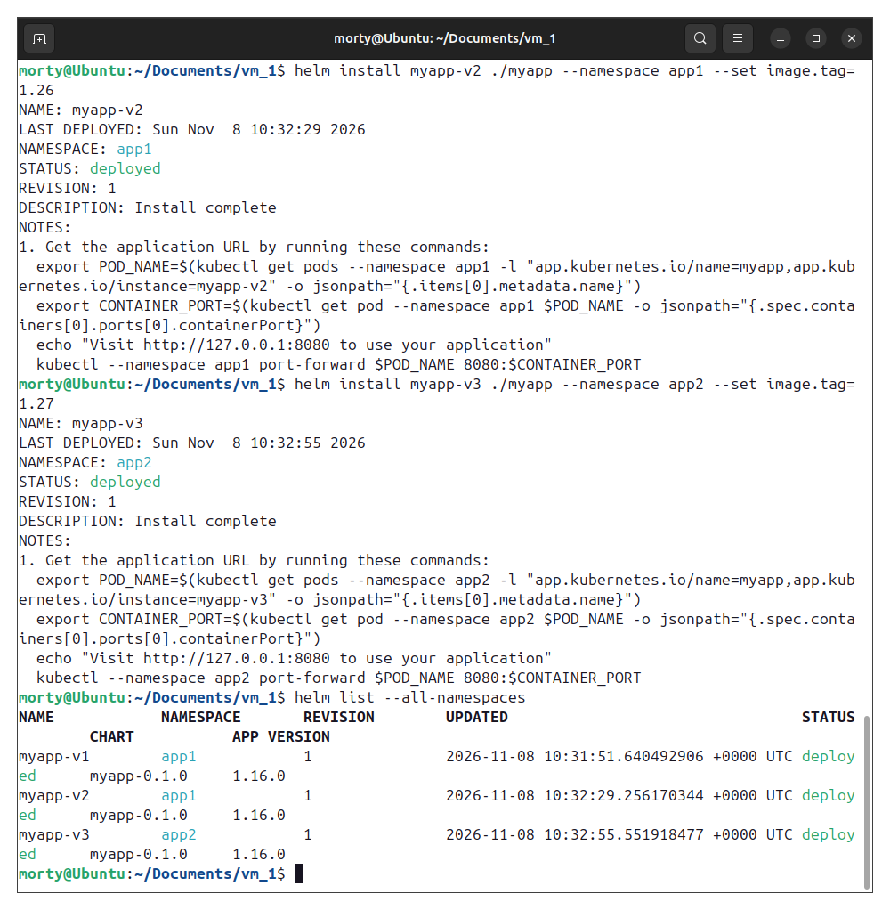
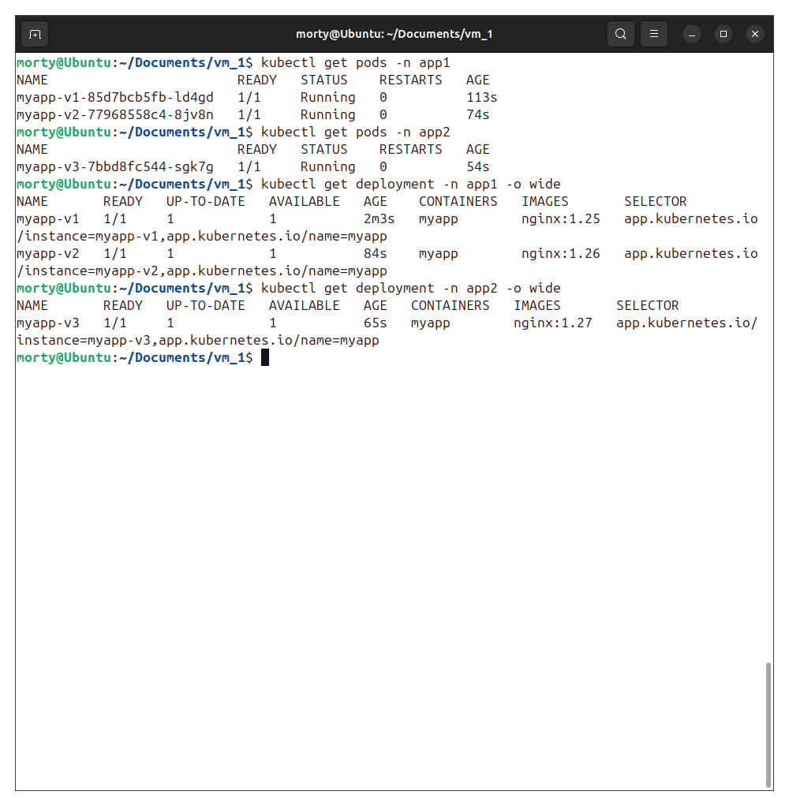

# Домашнее задание к занятию «Helm» - Лукинов Андрей

<b>Задание 1. Подготовить Helm-чарт для приложения</b>

1. Необходимо упаковать приложение в чарт для деплоя в разные окружения. 
2. Каждый компонент приложения деплоится отдельным deployment’ом или statefulset’ом.
3. В переменных чарта измените образ приложения для изменения версии.

    Чарт создан командой `helm create myapp`, [находится](./files/myapp/) в репозитории.

    

---

<b>Задание 2. Запустить две версии в разных неймспейсах</b>

1. Подготовив чарт, необходимо его проверить. Запуститe несколько копий приложения.
2. Одну версию в namespace=app1, вторую версию в том же неймспейсе, третью версию в namespace=app2.
3. Продемонстрируйте результат.

    

    

    

---