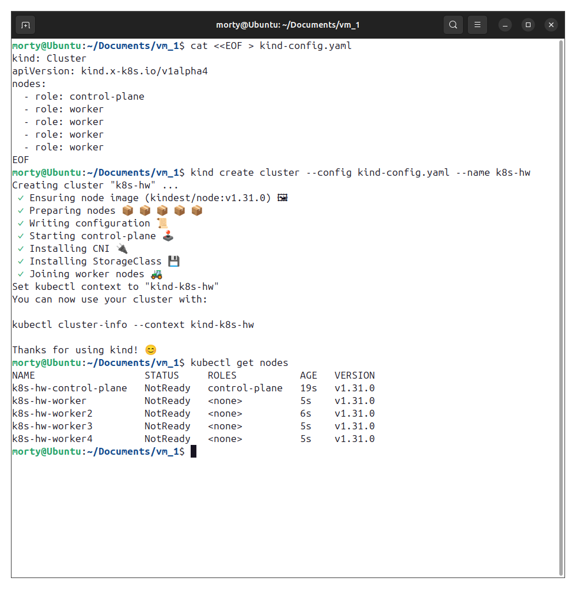

# Домашнее задание к занятию «Установка Kubernetes» - Лукинов Андрей

<b>Задание 1. Установить кластер k8s с 1 master node</b>

1. Подготовка работы кластера из 5 нод: 1 мастер и 4 рабочие ноды.
2. В качестве CRI — containerd.
3. Запуск etcd производить на мастере.
4. Способ установки выбрать самостоятельно.

    Для выполнения на одной ВМ был выбран инструмент kind.

    [Файл конфигурации](./files/kind-config.yaml)

    

    Containerd используется как CRI по умолчанию в kind, а etcd запущен на control-plane ноде.

---

<b>Задание 2*. Установить HA кластер</b>

1. Установить кластер в режиме HA.
2. Использовать нечётное количество Master-node.
3. Для cluster ip использовать keepalived или другой способ.

---